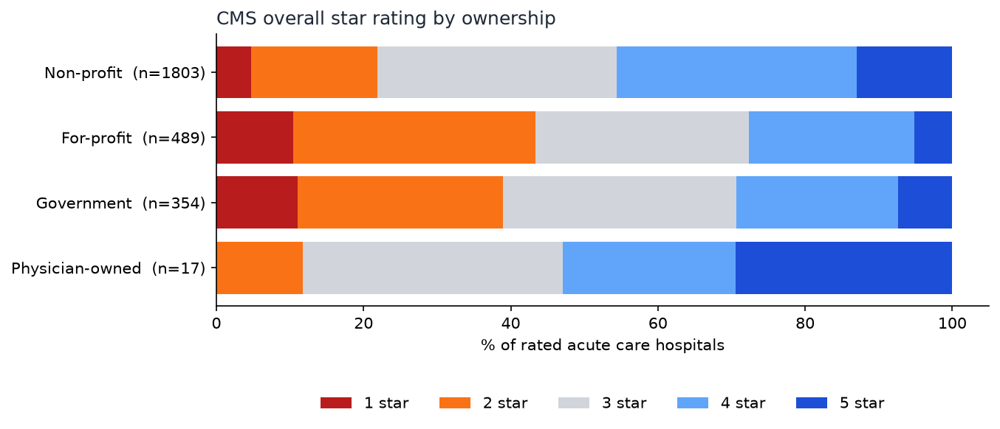

# Hospital Quality Analytics

What do CMS hospital star ratings tell you, and what do they not? This project analyses all 5,419 hospitals in the CMS Care Compare data. It covers who gets rated at all, whether ownership predicts the rating after controlling for state, how much states really differ, and how ratings line up with Medicare's readmission-penalty data. It uses SQL in DuckDB, statistics in SciPy/NumPy, and charts in matplotlib.

> **Status: learning project (September 2026).** It is built, tested, and run on the real public CMS data, but I am still practising explaining it. Every result here is **descriptive and associational**. Nothing in it says that ownership or location *causes* quality, and a star rating is a CMS composite score, not a measured patient outcome.



## Quickstart

```bash
cd hospital-quality-analytics
python3 -m venv .venv && source .venv/bin/activate
python -m pip install -e '.[dev]'

python -m pytest -q tests          # 14 tests, offline

hospital-quality download          # 3 pinned CMS files, SHA-256 verified (~3.5 MB)
hospital-quality analyze           # SQL + statistics -> outputs/*.csv, charts, summary.json (~2 s)
```

## Headline results (CMS snapshot of 2026-07-22)

| Question | Answer |
|---|---|
| How many hospitals have a star rating? | 3,174 of 5,419 (**58.6%**). No psychiatric or children's hospital is rated, and only 28.9% of critical access hospitals are |
| Do non-profit acute care hospitals rate higher than for-profit ones? | Yes, by **0.53 stars** on average (3.32 vs 2.79). Rank-biserial −0.27, Holm-adjusted p < 1e−20 |
| ... after comparing only within the same state? | **0.529 stars**, essentially unchanged. None of 10,000 within-state label shuffles came close (p ≈ 1e−4, the floor for 10,000 permutations) |
| Could unrated hospitals explain the gap? | Only if the 158 unrated for-profit hospitals averaged **4.96 stars**, or 4.28 even if every unrated non-profit were 1 star. That is implausible |
| Do states really differ? | 16 of 38 states (those with ≥ 15 rated hospitals) have a 95% interval that excludes the national mean of 3.16, where about 2 would be expected by chance. Arizona: 3.02 [2.74, 3.31], not distinguishable from the national mean |
| Do higher-rated hospitals have fewer excess readmissions? | Spearman ρ = **−0.44** (n = 2,377). **This is partly circular**, because readmission is one of the five measure groups inside the star rating |

Full tables and reasoning: [docs/results.md](docs/results.md). Method: [docs/how-it-works.md](docs/how-it-works.md).

## What I would say about the ownership result in an interview

The gap is real in this data and it is not a geography artifact. The effect is still **modest**: ownership explains about 4.6% of the rank variance (ε² = 0.046), and each of the three large ownership groups spans the full 1-to-5 range. The dataset has no bed count, teaching status, patient mix, or safety-net status, so any of those could sit behind the ownership difference. The correct sentence is "for-profit acute care hospitals in this snapshot are rated lower, within the same state". It is not "for-profit ownership lowers quality".

## Data

These are public CMS Provider Data Catalog files, pinned by URL and SHA-256 in `src/hospital_quality/data.py`:
- Hospital General Information (xubh-q36u), modified 2026-07-22
- Hospital Readmissions Reduction Program, FY 2026 (9n3s-kdb3), performance period 07/2021–06/2024
- Footnote Crosswalk (y9us-9xdf), used to report missing-rating reasons in CMS's own words
