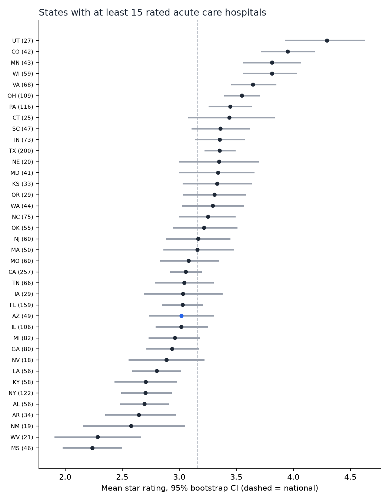
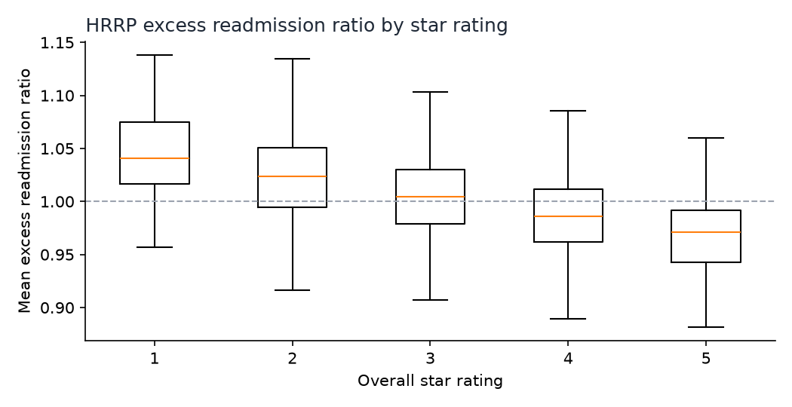

# Results — run of 2026-09-22

Every number is produced by `hospital-quality analyze` on the pinned, checksum-verified CMS files. The permutation test uses a fixed seed (0) and the bootstrap uses one seed per state, so re-running reproduces these numbers exactly.

## 1. Who gets rated at all

| Hospital type | Hospitals | Rated | % rated | Main reason for no rating (CMS footnote) |
|---|---:|---:|---:|---|
| Acute Care Hospitals | 3,107 | 2,663 | 85.7 | 16 — too few measures or measure groups reported |
| Critical Access Hospitals | 1,382 | 399 | 28.9 | 16 — too few measures or measure groups reported |
| Psychiatric | 624 | 0 | 0.0 | 19 — only IQR/OQR program participants shown |
| Acute Care – Veterans Administration | 132 | 112 | 84.8 | 16 |
| Childrens | 94 | 0 | 0.0 | 19 |
| Rural Emergency Hospital | 43 | 0 | 0.0 | 19 |
| Acute Care – Department of Defense | 32 | 0 | 0.0 | 22 — not calculated for DoD hospitals |
| Long-term | 5 | 0 | 0.0 | 19 |

**41.4% of hospitals have no rating.** A "average star rating of US hospitals" is therefore an average over a selected subset, which mostly leaves out small rural hospitals. All comparisons below are restricted to *rated general acute care hospitals* (n = 2,663), so like is compared with like.

## 2. Ownership

| Group | Rated | Mean | Median | % 4–5 stars | % 1–2 stars |
|---|---:|---:|---:|---:|---:|
| Non-profit | 1,803 | 3.319 | 3 | 45.6 | 21.9 |
| For-profit | 489 | 2.789 | 3 | 27.6 | 43.4 |
| Government | 354 | 2.867 | 3 | 29.4 | 39.0 |
| Physician-owned | 17 | 3.706 | 4 | 52.9 | 11.8 |

**Tests.** Star ratings are ordinal, so the tests are rank-based. Groups smaller than 30 are excluded from testing, which excludes physician-owned (n = 17). As section 3 shows, only 23.6% of those hospitals are rated at all.

- Kruskal–Wallis across non-profit / for-profit / government: H = 120.8, p = 5.8e−27, **ε² = 0.046** (a small effect).
- Pairwise Mann–Whitney, Holm-adjusted:

| Comparison | Rank-biserial | Holm p |
|---|---:|---:|
| For-profit vs non-profit | −0.272 | 2.8e−21 |
| Government vs non-profit | −0.230 | 2.3e−12 |
| For-profit vs government | −0.040 | 0.31 |

Rank-biserial −0.27 means that for a random for-profit / non-profit pair, the non-profit is rated higher 27 percentage points more often than the reverse. For-profit and government hospitals are not distinguishable from each other.

**Is it just geography?** For-profit hospitals are concentrated in some states (for example 36% of rated acute care hospitals in Texas, and 0.8% in New York). A stratified permutation test compares non-profit with for-profit hospitals *within each state*. It weights each state by nₐ·n_b/n and shuffles labels only inside states.

| | Non-profit − for-profit (mean stars) |
|---|---:|
| Naive difference | 0.530 |
| Within-state difference | 0.529 |
| p (10,000 within-state permutations) | 1.0e−4 (none as extreme) |
| States contributing / hospitals | 46 / 2,292 |

State composition explains almost none of the gap.

## 3. Could missing ratings explain the gap?

| Group (acute care) | Hospitals | Rated | % rated |
|---|---:|---:|---:|
| Non-profit | 1,943 | 1,803 | 92.8 |
| For-profit | 647 | 489 | 75.6 |
| Government | 445 | 354 | 79.6 |
| Physician-owned | 72 | 17 | 23.6 |

For-profit hospitals go unrated more often, so the comparison could in principle be biased by selection. The break-even check asks: what would the 158 unrated for-profit hospitals have to average for the full for-profit group to match non-profits?

- If unrated non-profits look like rated ones: **4.96 stars**.
- Even if all 140 unrated non-profits were 1-star: **4.28 stars**.

Both are far above what any rated group achieves (the for-profit rated mean is 2.79). Unrated hospitals are mostly small ones that report too few measures, and there is no reason to expect them to be exceptional. Selection alone is an implausible explanation for the gap.

## 4. States

For the 38 states with at least 15 rated acute care hospitals, each state mean has a 95% bootstrap interval (5,000 resamples).

- **16 of 38 intervals exclude the national mean of 3.164.** With 38 independent 95% intervals, about 2 would miss by chance, so real state-level variation exists.
- Highest: Utah 4.30 [3.93, 4.63], Colorado 3.95, Minnesota 3.81, Wisconsin 3.81. Lowest: Mississippi 2.24 [1.98, 2.50], West Virginia 2.29, New Mexico 2.58.
- **Arizona: 3.02 [2.74, 3.31] over 49 hospitals**, which is not distinguishable from the national mean.
- New York rates low (2.71) with almost no for-profit hospitals, so ownership does not explain state differences by itself.

A caution on the intervals: a state's rated hospitals are close to the *whole population* of its rated hospitals, not a sample from it. The bootstrap interval should be read as "how stable is this mean to the particular hospitals it contains", not as sampling error from a survey.

## 5. Readmissions (HRRP FY 2026)

| Condition | Hospitals with a ratio | % reported | Median ERR | % above 1.0 |
|---|---:|---:|---:|---:|
| AMI | 1,736 | 56.8 | 0.9995 | 49.7 |
| CABG | 878 | 28.7 | 1.0000 | 49.9 |
| COPD | 2,323 | 76.0 | 0.9969 | 47.2 |
| Heart failure | 2,621 | 85.8 | 0.9983 | 48.9 |
| Hip/knee | 1,447 | 47.4 | 0.9916 | 47.9 |
| Pneumonia | 2,715 | 88.9 | 0.9955 | 46.8 |

The excess readmission ratio is **relative by construction**: it compares a hospital's predicted rate with the rate expected for an average hospital with its patients. The median therefore sits near 1.0 and about half of hospitals are "above expected" every year. "47% of hospitals have excess readmissions" is a property of the metric, not a finding.

**Stars vs mean ERR** (hospitals with ≥ 3 reportable conditions, n = 2,377): Spearman ρ = −0.44. The median mean-ERR falls steadily from 1.04 at 1 star to 0.97 at 5 stars.

**Why this is weaker evidence than it looks:** readmission is one of the five measure groups that make up the overall star rating, so part of this correlation is the rating agreeing with one of its own inputs. The two data sources also cover different measurement periods. This is a consistency check, not independent validation of the star rating.

## Known limits

- One quarterly snapshot. Ratings change as CMS updates its methodology and data.
- No hospital size, teaching status, case mix, or payer mix, so every ownership and state result could be confounded by these.
- Stars are treated as ordinal in the tests, but the adjusted difference and state means are reported in mean stars for readability.
